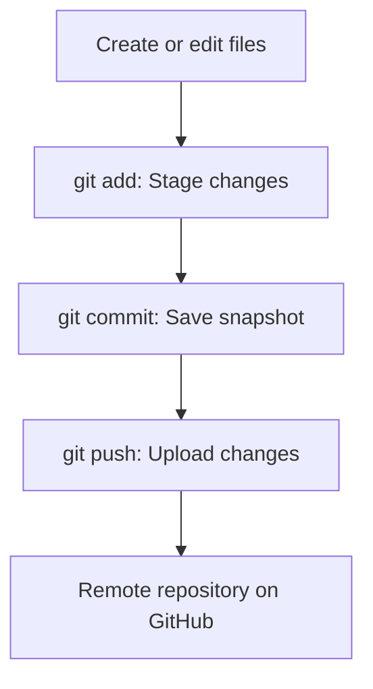

# SOFTWARE ENGINEERING LAB • PRACTICAL RECORD

# EXPERIMENT 5 — Version Control Systems Comparison
**Compare and contrast different version control systems**

| Student name | Roll number | Class / division | Subject |
|---|---|---|---|
| Aayan Vajir Nadaf | A124 | TY-CSE (A) | Software Engineering |

## Aim
To compare different Version Control Systems (VCS) and demonstrate a basic version-control workflow using Git.

## Objectives
- Understand local, centralized, and distributed version control.
- Compare Git, Apache Subversion (SVN), and Mercurial.
- Track file changes and view project history using Git commands.

## 1. Theory
A Version Control System is a tool that records changes made to files over time. It helps developers collaborate, maintain a history of changes, create branches, and restore earlier versions when needed.

| Type | Description | Example |
|---|---|---|
| Local VCS | Stores file versions on one computer. | Local revision database |
| Centralized VCS (CVCS) | A central server stores the repository; clients check out and commit changes. | SVN |
| Distributed VCS (DVCS) | Each clone contains repository history, enabling most work offline. | Git, Mercurial |

## 2. Comparison of VCS tools
| Feature | Git | SVN | Mercurial |
|---|---|---|---|
| Model | Distributed | Centralized | Distributed |
| Offline commits | Yes | Usually requires server access | Yes |
| Branching and merging | Flexible and widely used | Supported | Supported |
| Typical strengths | Large ecosystem; GitHub/GitLab integration | Centralized control and permissions | Consistent commands and distributed workflow |
| Suitable for | Modern team and open-source projects | Teams preferring a central repository | Distributed development projects |

## 3. Diagram: Git workflow


## 4. Practical implementation / live demo
Run the following commands in a terminal after installing Git. This demonstrates a real local repository; it does not require a GitHub account.

```bash
mkdir VCS-Experiment
cd VCS-Experiment
git init
echo "Hello, Version Control System!" > hello.txt
git add hello.txt
git commit -m "First commit"
echo "This is my first VCS experiment." >> hello.txt
git status
git add hello.txt
git commit -m "Update hello file"
git log --oneline
```

If Git requests identity details, configure them before committing:

```bash
git config --global user.name "Your Name"
git config --global user.email "your-email@example.com"
```

| Command | Expected observation |
|---|---|
| `git init` | Creates an empty local repository. |
| `git status` | Shows changed, staged, or untracked files. |
| `git commit` | Records a snapshot in repository history. |
| `git log --oneline` | Displays saved commits. |

## Result
Git, SVN, and Mercurial were compared. A basic Git workflow was demonstrated using repository initialization, staging, commits, status checking, and viewing commit history.
