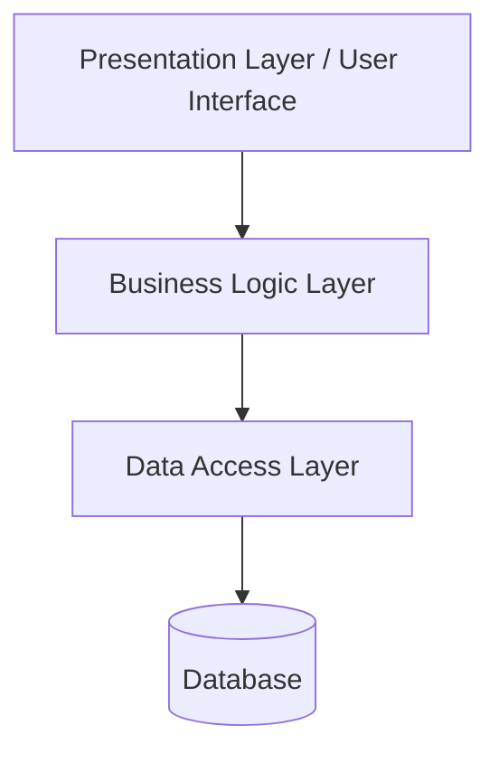
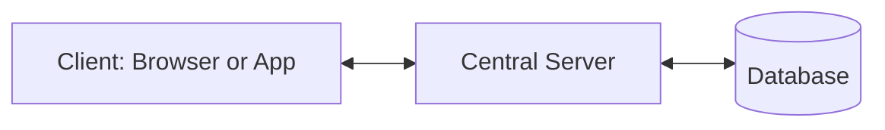
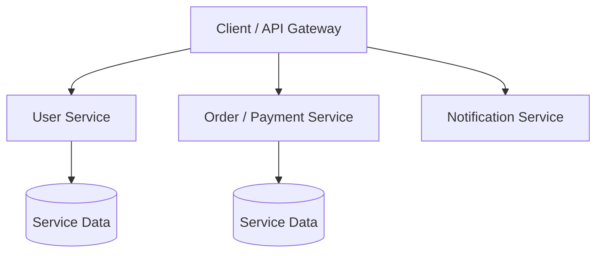

# SOFTWARE ENGINEERING LAB • PRACTICAL RECORD

# EXPERIMENT 6 — Software Architecture Design
**Design and compare different software architectures**

| Student name | Roll number | Class / division | Subject |
|---|---|---|---|
| Aayan Vajir Nadaf | A124 | TY-CSE (A) | Software Engineering |

## Aim
To design and compare layered, client-server, and microservices architectures for software applications.

## Objectives
- Understand the purpose of software architecture.
- Identify components and their relationships.
- Choose an architecture based on complexity, scalability, and maintenance needs.

## 1. Theory
Software architecture defines the major components of a system, their responsibilities, and how they communicate. A suitable architecture supports maintainability, security, reliability, and scalability.

## 2. Layered architecture

The system is divided into layers. The presentation layer handles the interface, the business layer applies rules, the data-access layer communicates with storage, and the database stores persistent data. Example: a college management system.

## 3. Client-server architecture
| Component | Responsibility |
|---|---|
| Client | Web browser or mobile app that sends requests and displays responses. |
| Server | Processes requests, applies business rules, and controls access. |
| Database | Stores user, course, attendance, or transaction records. |

Clients communicate with a central server, which may read or update the database before returning a response. Example: an online student portal. Centralized administration is an advantage; server overload or failure can affect many clients.

## 4. Microservices architecture
| Service | Example responsibility |
|---|---|
| User service | Registration and profile |
| Order/payment service | Orders or payment processing |
| Notification service | Email or app notifications |

The application is divided into small, independently deployable services that communicate through APIs or messaging. Services can scale independently, but deployment, monitoring, communication, and data consistency are more complex.

## 5. Architecture comparison
| Feature | Layered | Client-server | Microservices |
|---|---|---|---|
| Structure | Layers by responsibility | Clients and central server | Independent business services |
| Complexity | Low to medium | Medium | High |
| Scaling | Often scales as a larger unit | Server capacity must be managed | Individual services scale independently |
| Suitable for | Small/medium business apps | Web portals | Large, complex applications |

## 6. Procedure
1. Identify application requirements and expected workload.
2. List the main components and responsibilities.
3. Draw the component flow and define communication.
4. Compare the architectures against cost, complexity, scaling, and maintenance.
5. Select the architecture that best matches the project constraints.

## Result
Layered, client-server, and microservices architectures were described and compared. Architecture selection depends on system size, business needs, team skills, and operational complexity.
