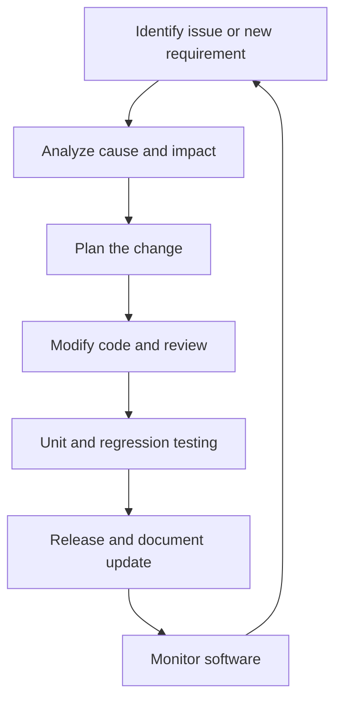

# SOFTWARE ENGINEERING LAB • PRACTICAL RECORD

# EXPERIMENT 7 — Software Maintenance and Evolution
**Compare and contrast software maintenance and evolution techniques**

| Student name | Roll number | Class / division | Subject |
|---|---|---|---|
| Aayan Vajir Nadaf | A124 | TY-CSE (A) | Software Engineering |

## Aim
To study and compare corrective, adaptive, perfective, and preventive software maintenance.

## Objectives
- Understand why software changes after deployment.
- Classify maintenance activities by purpose.
- Apply maintenance categories to a sample Student Management System.

## 1. Theory
Software maintenance modifies software after delivery to fix defects, adapt to a changed environment, improve features or performance, or reduce the risk of future failures. Software evolution is the ongoing change of software as requirements and technology change.

## 2. Types of maintenance
| Type | Purpose | Example in a student system |
|---|---|---|
| Corrective | Fix an existing defect. | Correct an attendance total calculated incorrectly. |
| Adaptive | Keep software working in a changed environment. | Update database connectivity after a database version change. |
| Perfective | Improve functionality, usability, or performance. | Add report export or search filters. |
| Preventive | Reduce future maintenance risk and improve structure. | Refactor complex code and add automated tests. |

## 3. Diagram: Maintenance cycle

## 4. Practical procedure
1. Identify the issue or new requirement.
2. Analyze the cause, impact, and affected components.
3. Plan the change and update requirements or design notes.
4. Modify the code and review the change.
5. Run unit tests and regression tests.
6. Release the update, document it, and monitor for new issues.

## 5. Comparison
| Aspect | Corrective | Adaptive | Perfective | Preventive |
|---|---|---|---|---|
| Trigger | Defect found | Environment changes | User improvement request | Future risk / poor maintainability |
| Main goal | Restore correct behavior | Maintain compatibility | Improve value or quality | Reduce future failures |
| Example | Fix login bug | Support new OS | Add dashboard | Refactor module |

## 6. Testing note
Regression testing checks that a change has not broken features that previously worked. It should be performed after maintenance changes, together with tests for the changed behavior.

## Result
The four major types of software maintenance were studied and compared. The type is selected according to whether the change fixes a defect, adapts to an environment, improves features, or prevents future problems.
