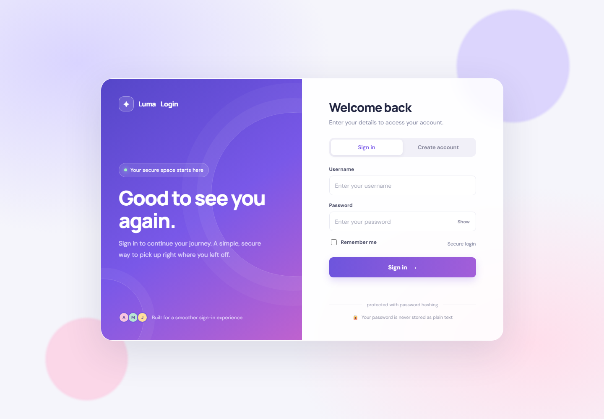
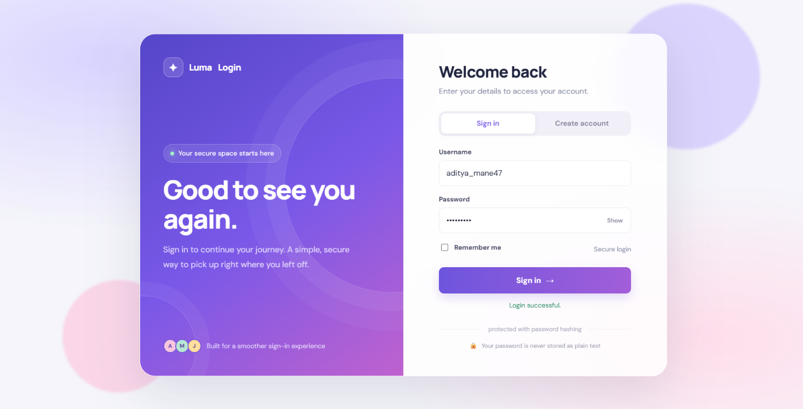

# Experiment 09 — Software Engineering Tools & Technologies

A classroom login-system demo built to explore how software tools and technologies work together in a small web application.

## Project Overview

The project provides a browser-based registration and login page. The page sends requests to a Python API, which stores user accounts in a MySQL database and checks passwords using secure password hashing.

## Technologies Used

| Technology | Role in this project |
|---|---|
| HTML, CSS, JavaScript | Login and registration interface |
| Python and Flask | Backend web server and API |
| MySQL | Stores usernames and password hashes |
| Git and GitHub | Version control and project hosting |

### Comparison

- **C:** A compiled language that offers low-level control and is useful for systems programming. This implementation does not currently include a C component.
- **Python with Flask:** Concise and well suited to building a small web backend and API. It is used for the server and login logic here.
- **MySQL:** A relational database with a defined table structure, suitable for storing account records.
- **MongoDB:** A document database with a flexible document structure. It is an alternative considered for this project; MySQL was selected.

## Features

- Register an account with a unique username.
- Log in using a username and password.
- Hash passwords before storing them.
- Use parameterized SQL queries for database operations.
- Display success or error messages in the browser.

## Project Structure

```text
Experiment-09-Software Engineering Tools & Technologies/
├── app.py
├── requirements.txt
├── .gitignore
├── README.md
├── screenshots/
│   └── login-page.png
└── templates/
    └── index.html
```

## Requirements

- Python 3
- MySQL Server
- A web browser

## Setup on Windows

### 1. Create the MySQL database and table

Sign in to MySQL as an administrator, then run:

```sql
CREATE DATABASE IF NOT EXISTS login_demo;
USE login_demo;

CREATE TABLE IF NOT EXISTS users (
    id INT AUTO_INCREMENT PRIMARY KEY,
    username VARCHAR(100) NOT NULL UNIQUE,
    password_hash VARCHAR(255) NOT NULL,
    created_at TIMESTAMP DEFAULT CURRENT_TIMESTAMP
);
```

Create a limited database account for the application. Replace the example password with your own private password:

```sql
CREATE USER IF NOT EXISTS 'login_app'@'localhost'
IDENTIFIED BY 'choose-your-own-password';

GRANT SELECT, INSERT ON login_demo.users
TO 'login_app'@'localhost';
```

If the `login_app` account already exists, update its password with:

```sql
ALTER USER 'login_app'@'localhost'
IDENTIFIED BY 'choose-your-own-password';
```

### 2. Create a local environment file

From the project folder, create a file named `.env` with these settings. Replace the example password with the password set for the MySQL `login_app` account.

```text
DB_HOST=127.0.0.1
DB_USER=login_app
DB_PASSWORD=your-private-password
DB_NAME=login_demo
```

Do not commit `.env` to GitHub. The `.gitignore` file excludes it.

### 3. Install the Python dependencies

Run these commands from the project folder in PowerShell:

```powershell
py -m venv .venv
.\.venv\Scripts\python.exe -m pip install -r requirements.txt
```

### 4. Start the application

```powershell
.\.venv\Scripts\python.exe app.py
```

Keep the PowerShell window open and visit:

```text
http://127.0.0.1:5000/
```

The API health endpoint is:

```text
http://127.0.0.1:5000/api/health
```

## API Endpoints

| Method | Endpoint | Purpose |
|---|---|---|
| `GET` | `/api/health` | Check that the server is running |
| `POST` | `/api/register` | Create an account |
| `POST` | `/api/login` | Check login credentials |

Registration and login endpoints accept JSON containing `username` and `password`.

## Notes

This project is for local educational demonstration. The Flask development server is not intended for production use. The “Remember me” control is visual only and does not create a persistent login session.

## Screenshots

### Login page



### Successful login


